# Trading Bot — Complete Technical Documentation

## Table of Contents

1. [Overview](#overview)
2. [Architecture](#architecture)
3. [Project Structure](#project-structure)
4. [Configuration](#configuration)
5. [Backend Modules](#backend-modules)
6. [Strategies](#strategies)
7. [Backtest System](#backtest-system)
8. [AI Integration](#ai-integration)
9. [Risk Management](#risk-management)
10. [Frontend](#frontend)
11. [API Reference](#api-reference)
12. [Data Flow Diagrams](#data-flow-diagrams)

---

## Overview

Crypto trading bot supporting three modes:
- **Paper trading** — simulated trading with real-time prices
- **Live trading** — real money trading on Binance
- **Backtesting** — strategy testing against historical data

**Technology stack:**
- Backend: Python 3.12+, FastAPI, asyncio
- Frontend: React + TypeScript, Vite, TailwindCSS
- Exchange: CCXT (Binance)
- AI: Anthropic Claude Opus 4.6
- Indicators: pandas-ta
- Database: SQLite (aiosqlite)

---

## Architecture

### System Overview

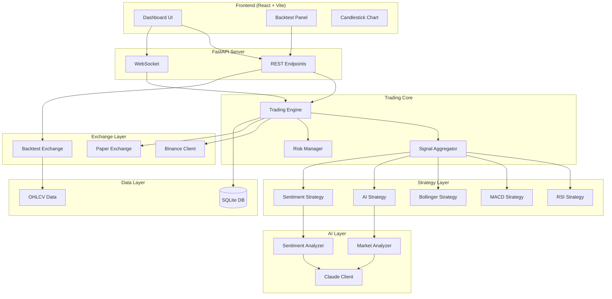

### Trading Modes

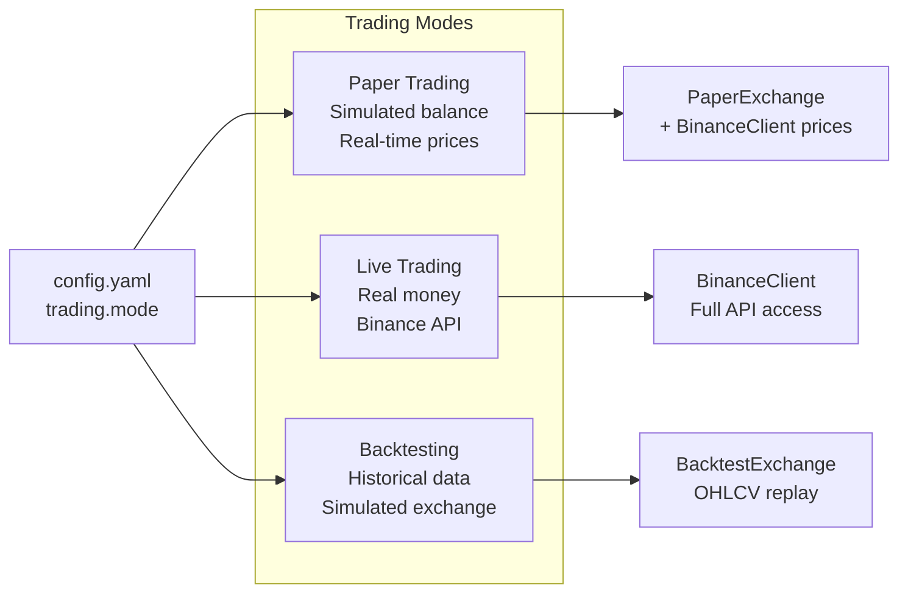

---

## Project Structure

```
tradingbot/
├── backend/
│   ├── main.py                 # CLI entry point — live/paper trading loop
│   ├── config.py               # All configuration (dataclasses)
│   ├── models.py               # Ticker, Order, Signal, Position, Trade
│   ├── database.py             # SQLite CRUD (aiosqlite)
│   ├── api/
│   │   ├── app.py              # FastAPI factory + lifespan
│   │   ├── routes.py           # REST endpoints + backtest orchestration
│   │   ├── deps.py             # Database dependency injection
│   │   └── websocket.py        # WebSocket live updates
│   ├── backtest/
│   │   ├── engine.py           # BacktestEngine + EngineConfig
│   │   ├── exchange.py         # BacktestExchange (fees, slippage)
│   │   ├── ai_filter.py        # AI simulation filter
│   │   ├── data_loader.py      # Binance OHLCV download + CSV
│   │   ├── report.py           # BacktestReport (Sharpe, drawdown etc)
│   │   └── runner.py           # CLI backtest runner
│   ├── core/
│   │   ├── engine.py           # TradingEngine (live loop)
│   │   ├── scheduler.py        # PeriodicTask utility
│   │   ├── safety.py           # Live trading safety checks
│   │   ├── logger.py           # structlog setup
│   │   └── exceptions.py       # Exception hierarchy
│   ├── exchange/
│   │   ├── base.py             # ExchangeBase ABC
│   │   ├── binance_client.py   # CCXT Binance wrapper
│   │   └── paper_exchange.py   # Simulated exchange
│   ├── strategies/
│   │   ├── base.py             # StrategyBase ABC
│   │   ├── technical.py        # RSI, MACD, Bollinger
│   │   ├── ai_strategy.py      # Claude AI strategy
│   │   └── sentiment.py        # News sentiment strategy
│   ├── ai/
│   │   ├── claude_client.py    # Anthropic API wrapper
│   │   ├── market_analyzer.py  # Market analysis with prompts
│   │   ├── sentiment_analyzer.py # News sentiment
│   │   └── prompts.py          # System + user prompts
│   └── risk/
│       └── manager.py          # Pre-trade risk checks
├── frontend/
│   └── src/
│       ├── App.tsx             # Dashboard + Backtest tabs
│       ├── api.ts              # REST client
│       ├── components/
│       │   ├── BacktestPanel.tsx    # Full backtest UI
│       │   ├── CandlestickChart.tsx # Lightweight Charts
│       │   ├── Header.tsx           # Header + status
│       │   ├── StatsPanel.tsx       # Portfolio statistics
│       │   ├── PortfolioChart.tsx   # Equity curve
│       │   ├── ConfigPanel.tsx      # Bot configuration
│       │   └── TradesTable.tsx      # Trades table
│       └── hooks/
│           └── useWebSocket.ts # WS hook
├── tests/                      # Tests (mirrors backend structure)
├── config.yaml                 # Main configuration
├── .env.example                # Environment variables
├── pyproject.toml              # Project metadata + tools
└── requirements.txt            # Python dependencies
```

---

## Configuration

### Configuration Hierarchy

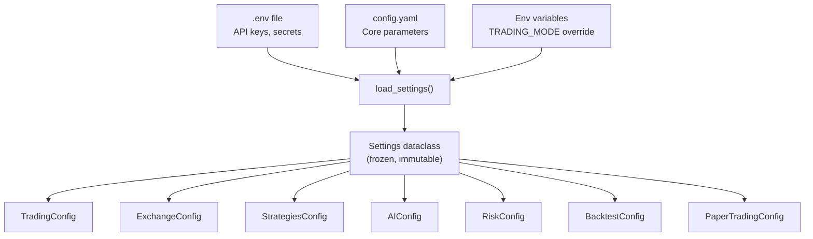

### All Configuration Values

#### TradingConfig
| Field | Type | Default | Description |
|-------|------|---------|-------------|
| `mode` | str | `"paper"` | Trading mode: `paper`, `live`, `backtest` |
| `pairs` | list[str] | `["BTC/USDT", "ETH/USDT"]` | Trading pairs |
| `timeframe` | str | `"1h"` | Candle interval |
| `poll_interval_seconds` | int | `60` | Tick interval in seconds |

#### ExchangeConfig
| Field | Type | Default | Description |
|-------|------|---------|-------------|
| `name` | str | `"binance"` | Exchange name |
| `sandbox` | bool | `False` | Whether to use testnet |
| `rate_limit_ms` | int | `100` | API rate limit in ms |

#### StrategiesConfig
| Field | Type | Default | Description |
|-------|------|---------|-------------|
| `enabled` | list[str] | `["rsi", "macd", "bollinger"]` | Active strategies |
| `rsi` | RSIConfig | — | RSI parameters |
| `macd` | MACDConfig | — | MACD parameters |
| `bollinger` | BollingerConfig | — | Bollinger parameters |

#### RSIConfig
| Field | Type | Default | Description |
|-------|------|---------|-------------|
| `period` | int | `14` | RSI calculation period (number of candles) |
| `oversold` | int | `30` | Oversold threshold (below this → BUY) |
| `overbought` | int | `70` | Overbought threshold (above this → SELL) |

#### MACDConfig
| Field | Type | Default | Description |
|-------|------|---------|-------------|
| `fast` | int | `12` | Fast EMA period |
| `slow` | int | `26` | Slow EMA period |
| `signal` | int | `9` | Signal line EMA period |

#### BollingerConfig
| Field | Type | Default | Description |
|-------|------|---------|-------------|
| `period` | int | `20` | Moving average period |
| `std_dev` | float | `2.0` | Number of standard deviations for bands |

#### AIConfig
| Field | Type | Default | Description |
|-------|------|---------|-------------|
| `model` | str | `"claude-opus-4-6"` | Claude model ID |
| `max_calls_per_minute` | int | `10` | API rate limit |
| `analysis_cache_ttl_seconds` | int | `300` | Market analysis cache TTL |
| `sentiment_cache_ttl_seconds` | int | `900` | Sentiment cache TTL |
| `max_tokens_analysis` | int | `4096` | Max tokens for analysis |
| `max_tokens_sentiment` | int | `1024` | Max tokens for sentiment |

#### RiskConfig
| Field | Type | Default | Description |
|-------|------|---------|-------------|
| `max_position_pct` | float | `0.10` | Max position size (% of balance) |
| `stop_loss_pct` | float | `0.03` | Fixed stop-loss % |
| `trailing_stop_pct` | float | `0.02` | Trailing stop % from peak |
| `max_drawdown_pct` | float | `0.15` | Max drawdown before trading halt |
| `daily_loss_limit_pct` | float | `0.05` | Daily loss limit |
| `max_single_order_usdt` | float | `1000.0` | Max single order value in USDT |

#### BacktestConfig
| Field | Type | Default | Description |
|-------|------|---------|-------------|
| `default_start` | str | `"2025-01-01"` | Default start date |
| `default_end` | str | `"2025-12-31"` | Default end date |
| `default_balance` | float | `10000.0` | Starting balance |
| `data_cache_dir` | str | `"data/cache"` | OHLCV cache directory |

---

## Backend Modules

### Data Models (`backend/models.py`)

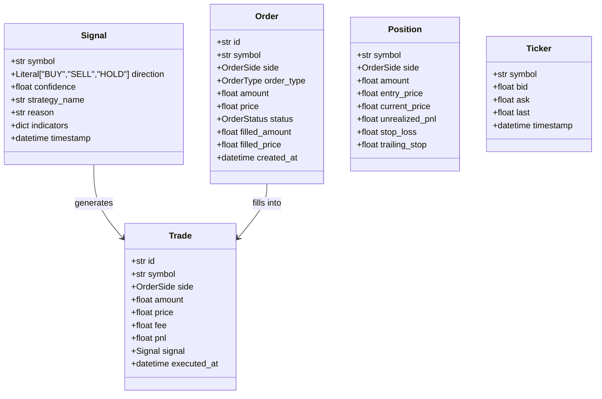

### Exchange Hierarchy

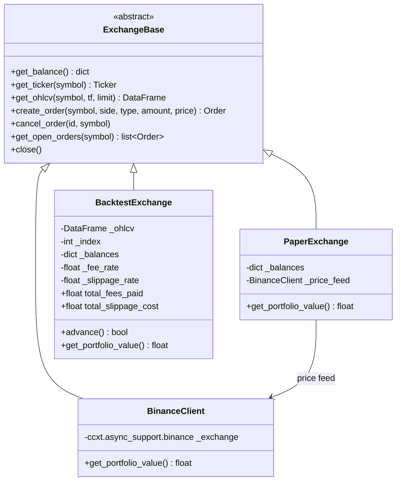

---

## Strategies

### Strategy Flow

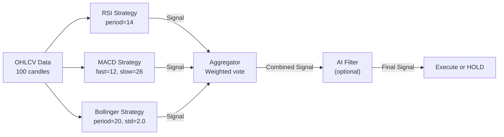

### Signal Aggregation

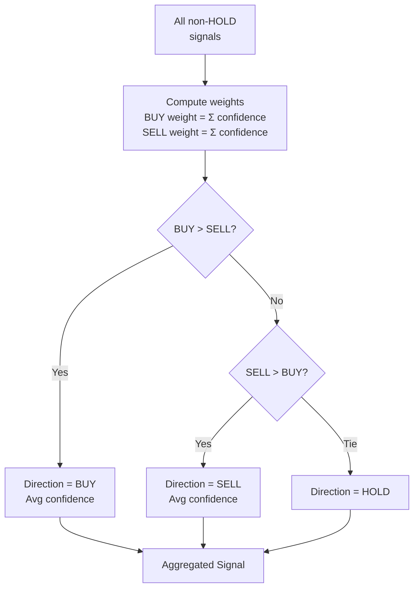

### RSI Strategy Logic

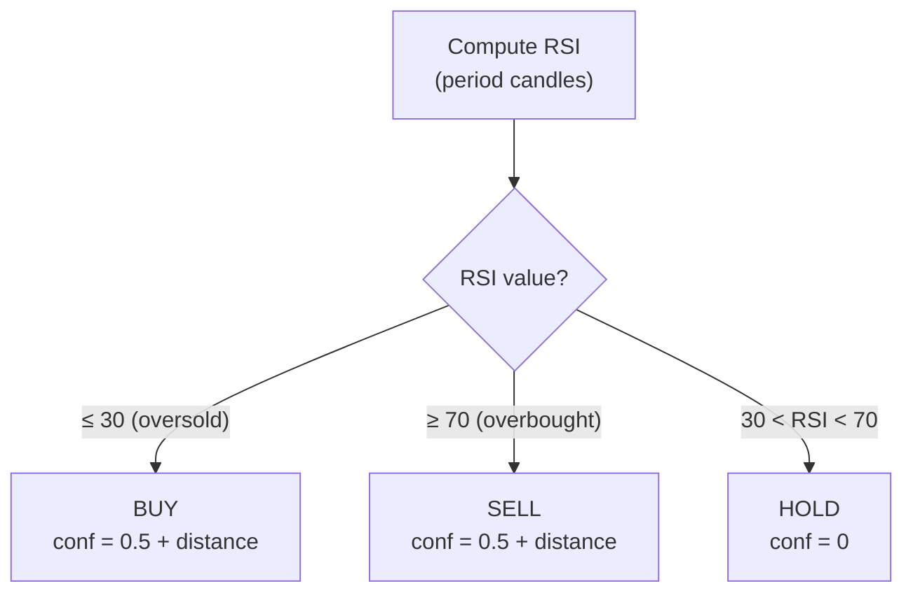

### MACD Strategy Logic

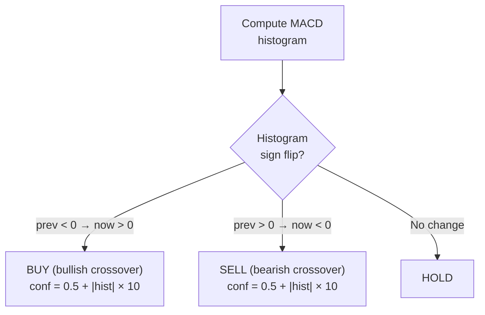

### Bollinger Strategy Logic

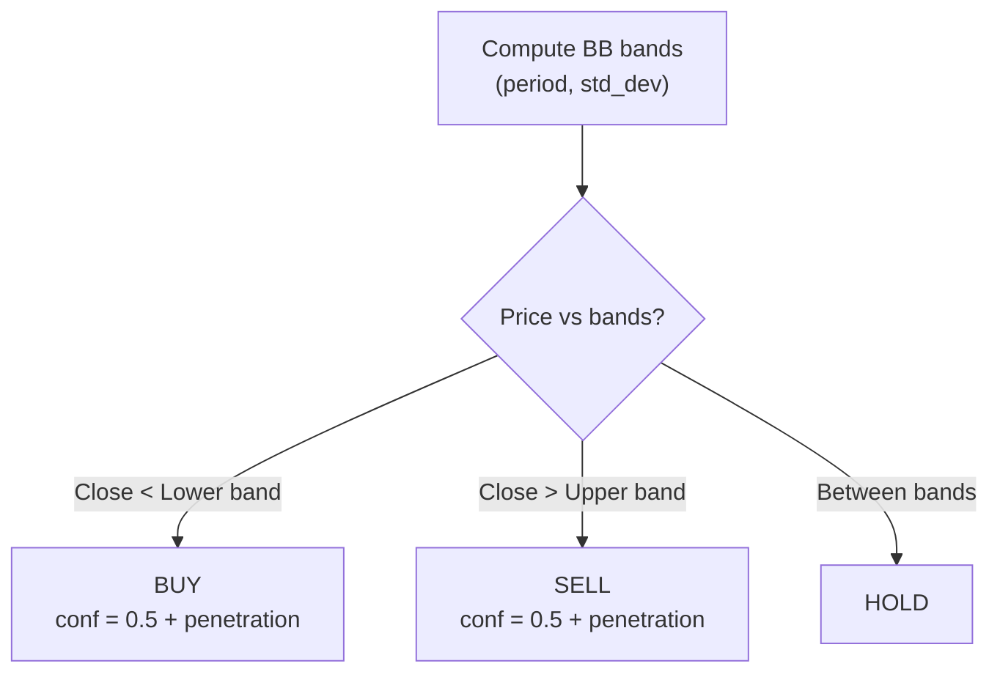

---

## Backtest System

### Complete Backtest Flow

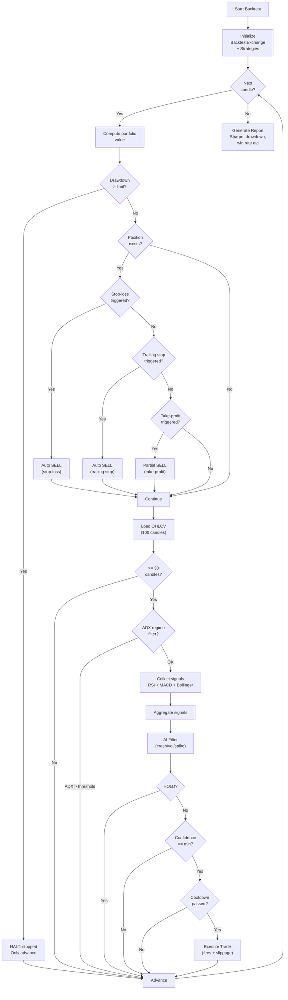

### EngineConfig Parameters

| Field | Type | Default | Description |
|-------|------|---------|-------------|
| `min_confidence` | float | `0.0` | Minimum signal confidence required |
| `cooldown_candles` | int | `0` | Candles between trades |
| `use_dynamic_sizing` | bool | `False` | Position size × confidence |
| `enable_regime_filter` | bool | `False` | ADX trending filter |
| `adx_period` | int | `14` | ADX indicator period |
| `adx_trending_threshold` | float | `25.0` | ADX threshold for trending market |
| `take_profit_pct` | float | `0.0` | Take-profit % (0 = disabled) |
| `take_profit_ratio` | float | `0.5` | Fraction of position to sell at TP |

### BacktestExchange Parameters

| Field | Type | Default | Description |
|-------|------|---------|-------------|
| `fee_rate` | float | `0.001` | Exchange fee per trade (0.1%) |
| `slippage_rate` | float | `0.0005` | Price slippage (0.05%) |

### Report Metrics (BacktestReport)

| Metric | Description |
|--------|-------------|
| `total_return_pct` | Total return % |
| `annualized_return_pct` | Annualized return % |
| `max_drawdown_pct` | Largest peak-to-trough decline |
| `sharpe_ratio` | Risk-adjusted return (risk-free 4%) |
| `sortino_ratio` | Like Sharpe but only downside volatility |
| `total_trades` | Total number of trades |
| `win_rate` | Percentage of profitable trades |
| `avg_trade_pnl` | Average P&L per trade |
| `best_trade_pnl` / `worst_trade_pnl` | Best/worst single trade |

---

## AI Integration

### AI Layers

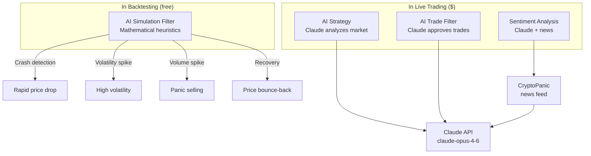

### AI Crash Filter Config

| Field | Type | Default | Description |
|-------|------|---------|-------------|
| `enabled` | bool | `False` | Filter on/off |
| `strength` | float | `0.5` | Filtering intensity (0–1) |
| `crash_lookback` | int | `10` | Candles for crash detection |
| `crash_threshold_pct` | float | `-5.0` | Crash threshold % |
| `volatility_lookback` | int | `20` | Volatility calculation period |
| `volatility_multiplier` | float | `2.0` | Volatility spike multiplier |
| `volume_spike_multiplier` | float | `2.5` | Volume spike multiplier |
| `recovery_boost` | float | `1.3` | Recovery BUY confidence boost |
| `min_confidence_threshold` | float | `0.3` | Min confidence before blocking |

### AI Filter Effect on Signals

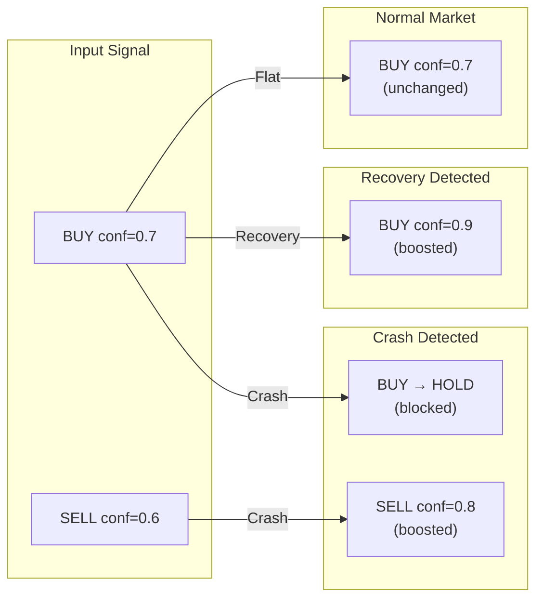

---

## Risk Management

### Risk Controls in Backtest

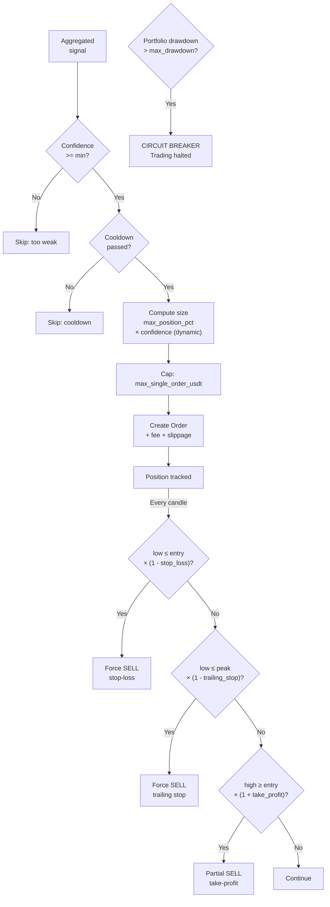

---

## Frontend

### Component Hierarchy

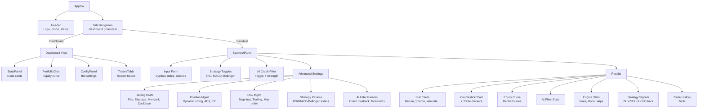

---

## API Reference

### REST Endpoints

All REST endpoints are prefixed with `/api`.

| Method | Path | Parameters | Response |
|--------|------|------------|----------|
| `GET` | `/api/health` | — | `{"status": "ok"}` |
| `GET` | `/api/config` | — | Bot configuration (mode, pairs, risk etc) |
| `GET` | `/api/trades` | `?symbol=&limit=50` | List of trades |
| `GET` | `/api/orders` | `?symbol=` | Open orders |
| `GET` | `/api/portfolio` | `?limit=100` | Portfolio history |
| `POST` | `/api/backtest` | JSON body (see below) | Report + equity + OHLCV + trades |

### WebSocket

| Path | Description |
|------|-------------|
| `/ws` | Live updates (trades, portfolio changes) |

### POST `/api/backtest` Request

```json
{
  "symbol": "BTC/USDT",
  "timeframe": "1h",
  "start": "2025-01-01",
  "end": "2025-06-30",
  "balance": 10000.0,
  "strategies": ["rsi", "macd", "bollinger"],
  "rsi": { "period": 14, "oversold": 30, "overbought": 70 },
  "macd": { "fast": 12, "slow": 26, "signal": 9 },
  "bollinger": { "period": 20, "std_dev": 2.0 },
  "risk": {
    "max_position_pct": 0.10,
    "stop_loss_pct": 0.03,
    "trailing_stop_pct": 0.02,
    "max_single_order_usdt": 1000.0
  },
  "ai_filter": {
    "enabled": false,
    "strength": 0.5,
    "crash_lookback": 10,
    "crash_threshold_pct": -5.0,
    "volatility_multiplier": 2.0,
    "volume_spike_multiplier": 2.5,
    "recovery_boost": 1.3
  },
  "engine": {
    "fee_rate": 0.001,
    "slippage_rate": 0.0005,
    "min_confidence": 0.0,
    "cooldown_candles": 0,
    "use_dynamic_sizing": false,
    "enable_regime_filter": false,
    "adx_trending_threshold": 25.0,
    "take_profit_pct": 0.0,
    "take_profit_ratio": 0.5
  }
}
```

### POST `/api/backtest` Response

```json
{
  "report": {
    "initial_value": 10000.0,
    "final_value": 10850.0,
    "total_return_pct": 8.5,
    "annualized_return_pct": 17.2,
    "max_drawdown_pct": 5.3,
    "sharpe_ratio": 1.24,
    "sortino_ratio": 1.89,
    "total_trades": 23,
    "winning_trades": 14,
    "losing_trades": 9,
    "win_rate": 60.9,
    "avg_trade_pnl": 36.96,
    "best_trade_pnl": 210.50,
    "worst_trade_pnl": -85.20,
    "strategy_stats": { "aggregator": { "BUY": 12, "SELL": 11, "HOLD": 3800 } },
    "ai_filter_stats": { "signals_reviewed": 0, "..." : "..." },
    "engine_stats": {
      "stop_loss_exits": 3,
      "trailing_stop_exits": 2,
      "take_profit_exits": 1,
      "drawdown_halt_candle": null,
      "signals_below_confidence": 5,
      "cooldown_skips": 8,
      "regime_filtered": 120,
      "total_fees": 23.45,
      "total_slippage": 11.22
    }
  },
  "equity_curve": [10000.0, 10002.5, "..."],
  "timestamps": ["2025-01-01T00:00:00+00:00", "..."],
  "ohlcv": [{ "time": 1735689600, "open": 42000, "high": 42500, "low": 41800, "close": 42200, "volume": 150.5 }],
  "trades": [{ "symbol": "BTC/USDT", "side": "BUY", "amount": 0.0023, "price": 42150.0, "executed_at": "2025-01-15T14:00:00+00:00", "portfolio_value": 10050.0 }]
}
```

---

## Data Flow Diagrams

### Live Trading Flow

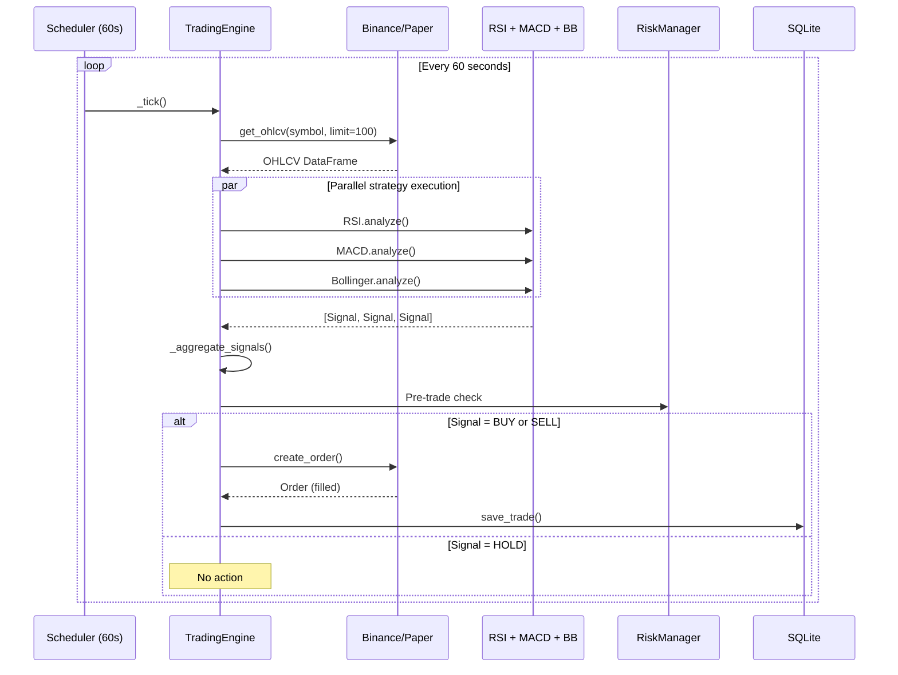

### Backtest Data Flow

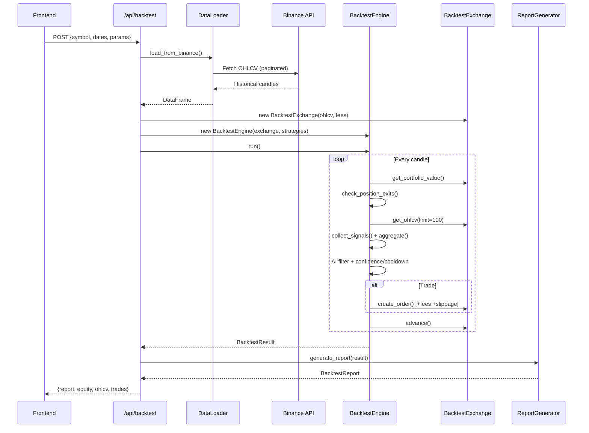

---

## Environment Variables (.env)

```bash
BINANCE_API_KEY=your_binance_api_key
BINANCE_API_SECRET=your_binance_api_secret
ANTHROPIC_API_KEY=your_anthropic_api_key
TRADING_MODE=paper          # paper | live | backtest
LOG_LEVEL=INFO              # DEBUG | INFO | WARNING
```

---

## Getting Started

```bash
# Backend (API server)
uvicorn backend.api.app:app --host 0.0.0.0 --port 8000

# Frontend (dev server)
cd frontend && npm run dev

# Live/Paper trading bot
python -m backend.main

# CLI backtest
python -m backend.backtest --symbol BTC/USDT --start 2025-01-01 --end 2025-06-30

# Tests
python -m pytest tests/ -v

# Lint
ruff check backend/ tests/
```

---

## Test Coverage

| Module | Test Count | Covered Functionality |
|--------|------------|----------------------|
| `tests/backtest/test_ai_filter.py` | 11 | Crash detection, recovery, strength, stats |
| `tests/backtest/test_engine.py` | 4 | Base engine execution, trending data, equity curve |
| `tests/backtest/test_engine_advanced.py` | 10 | Fees, slippage, stop-loss, trailing, cooldown, drawdown, dynamic sizing |
| `tests/backtest/test_exchange.py` | 11 | Exchange balances, orders, insufficient funds |
| `tests/backtest/test_data_loader.py` | 3 | CSV round-trip, timezone handling |
| `tests/backtest/test_report.py` | 7 | Drawdown, returns, Sharpe, report generation |
| **Total backtest** | **46** | |
| `tests/` (all) | **52+** | + core engine, strategies, AI, API, database |
