# Trading Bot — Complete Technical Documentation

## Table of Contents

1. [Overview](#overview)
2. [Architecture](#architecture)
3. [Project Structure](#project-structure)
4. [Configuration](#configuration)
5. [Backend Modules](#backend-modules)
6. [Strategies](#strategies)
7. [Backtest System](#backtest-system)
8. [Walk-Forward Validation](#walk-forward-validation)
9. [AI Integration](#ai-integration)
10. [Multi-LLM Veto System](#multi-llm-veto-system)
11. [Notifications (Telegram)](#notifications-telegram)
12. [Risk Management](#risk-management)
13. [Frontend](#frontend)
14. [API Reference](#api-reference)
15. [Data Flow Diagrams](#data-flow-diagrams)

---

## Overview

Crypto trading bot supporting three modes:
- **Paper trading** — simulated trading with real-time prices
- **Live trading** — real money trading on Binance
- **Backtesting** — strategy testing against historical data

**Technology stack:**
- Backend: Python 3.12+, FastAPI, asyncio
- Frontend: React + TypeScript, Vite, TailwindCSS
- Exchange: CCXT (Binance)
- AI: Anthropic Claude Opus 4.6; optional OpenAI (GPT-4o) for multi-LLM veto
- Indicators: pandas-ta
- Database: SQLite (aiosqlite)

**Notable features:**
- **Telegram alerts** — optional trade and error notifications via Bot API (`TELEGRAM_BOT_TOKEN` + `TELEGRAM_CHAT_ID`); wire `TelegramNotifier` into `TradingEngine` when starting the bot.
- **Walk-forward validation** — optional sequential train/test folds on the same backtest request (`walk_forward` in `POST /api/backtest`); UI in Backtest Advanced Settings.
- **Multi-LLM veto** — when `AIFilterStrategy` is constructed with a `VetoSystem`, Claude + OpenAI (and other `LLMProvider` implementations) must reach quorum before a BUY/SELL is approved. Configure via `AIConfig` (`veto_enabled`, `veto_min_agree`, `openai_model`) and `OPENAI_API_KEY`.

---

## Architecture

### System Overview

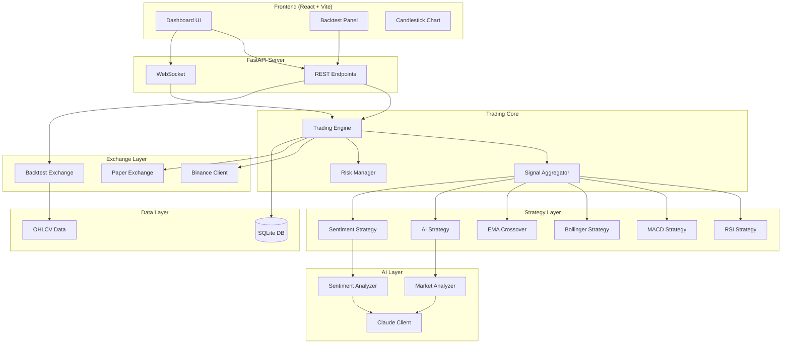

### Trading Modes

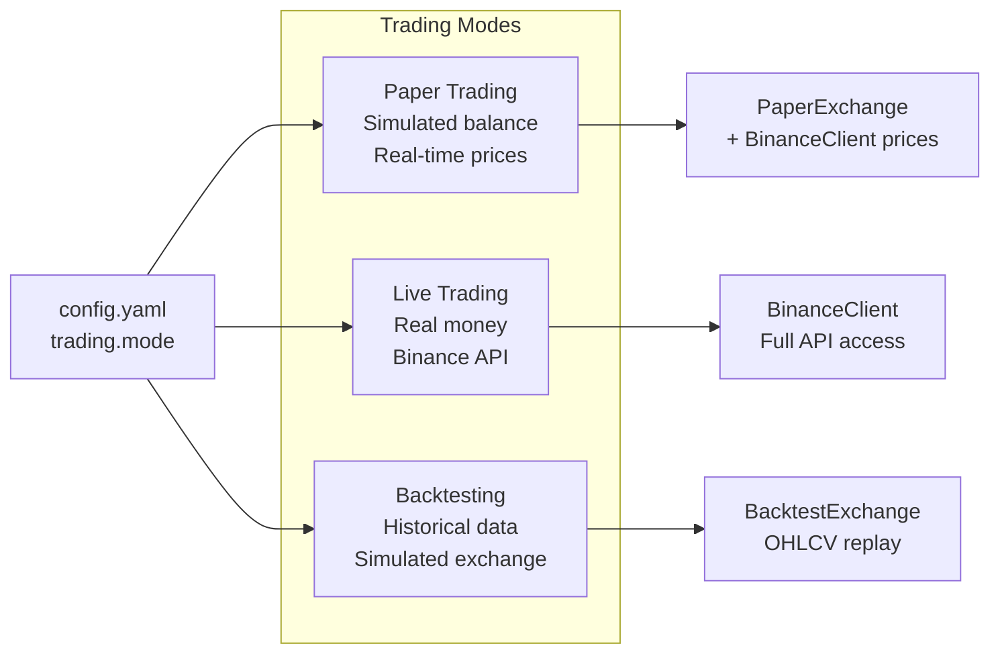

---

## Project Structure

```
tradingbot/
├── backend/
│   ├── main.py                 # CLI entry point — live/paper trading loop
│   ├── config.py               # All configuration (dataclasses)
│   ├── models.py               # Ticker, Order, Signal, Position, Trade
│   ├── database.py             # SQLite CRUD (aiosqlite)
│   ├── api/
│   │   ├── app.py              # FastAPI factory + lifespan
│   │   ├── routes.py           # REST endpoints + backtest orchestration
│   │   ├── deps.py             # Database dependency injection
│   │   └── websocket.py        # WebSocket live updates
│   ├── backtest/
│   │   ├── engine.py           # BacktestEngine + EngineConfig
│   │   ├── exchange.py         # BacktestExchange (fees, slippage)
│   │   ├── ai_filter.py        # AI simulation filter
│   │   ├── data_loader.py      # Binance OHLCV download + CSV
│   │   ├── report.py           # BacktestReport (Sharpe, drawdown etc)
│   │   ├── walk_forward.py     # Walk-forward folds + aggregate OOS metrics
│   │   ├── optimizer.py        # Optuna parameter optimizer
│   │   └── runner.py           # CLI backtest runner
│   ├── core/
│   │   ├── engine.py           # TradingEngine (live loop)
│   │   ├── regime.py           # ADX regime detection + dynamic weights
│   │   ├── scheduler.py        # PeriodicTask utility
│   │   ├── safety.py           # Live trading safety checks
│   │   ├── logger.py           # structlog setup
│   │   └── exceptions.py       # Exception hierarchy
│   ├── exchange/
│   │   ├── base.py             # ExchangeBase ABC
│   │   ├── binance_client.py   # CCXT Binance wrapper
│   │   └── paper_exchange.py   # Simulated exchange
│   ├── strategies/
│   │   ├── base.py             # StrategyBase ABC
│   │   ├── technical.py        # RSI, MACD, Bollinger, EMA Crossover
│   │   ├── ai_strategy.py      # Claude AI strategy
│   │   └── sentiment.py        # News sentiment strategy
│   ├── ai/
│   │   ├── base_provider.py    # LLMProvider ABC (veto)
│   │   ├── claude_client.py    # Anthropic API wrapper + LLMProvider
│   │   ├── openai_client.py    # OpenAI API wrapper (veto)
│   │   ├── veto_system.py      # Multi-LLM parallel quorum
│   │   ├── market_analyzer.py  # Market analysis with prompts
│   │   ├── sentiment_analyzer.py # News sentiment
│   │   └── prompts.py          # System + user prompts
│   ├── notifications/
│   │   └── telegram.py         # TelegramNotifier (Bot API via aiohttp)
│   └── risk/
│       └── manager.py          # Pre-trade risk checks
├── frontend/
│   └── src/
│       ├── App.tsx             # Dashboard + Backtest tabs
│       ├── api.ts              # REST client
│       ├── components/
│       │   ├── BacktestPanel.tsx    # Full backtest UI
│       │   ├── CandlestickChart.tsx # Lightweight Charts
│       │   ├── Header.tsx           # Header + status
│       │   ├── StatsPanel.tsx       # Portfolio statistics
│       │   ├── PortfolioChart.tsx   # Equity curve
│       │   ├── ConfigPanel.tsx      # Bot configuration
│       │   └── TradesTable.tsx      # Trades table
│       └── hooks/
│           └── useWebSocket.ts # WS hook
├── tests/                      # Tests (mirrors backend structure)
├── config.yaml                 # Main configuration
├── .env.example                # Environment variables
├── pyproject.toml              # Project metadata + tools
└── requirements.txt            # Python dependencies
```

---

## Configuration

### Configuration Hierarchy

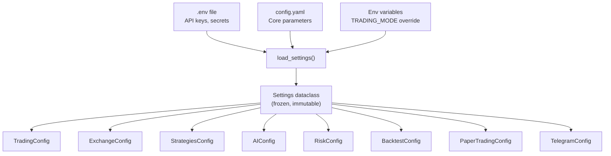

### All Configuration Values

#### TradingConfig
| Field | Type | Default | Description |
|-------|------|---------|-------------|
| `mode` | str | `"paper"` | Trading mode: `paper`, `live`, `backtest` |
| `pairs` | list[str] | `["BTC/USDT", "ETH/USDT"]` | Trading pairs |
| `timeframe` | str | `"1h"` | Candle interval |
| `poll_interval_seconds` | int | `60` | Tick interval in seconds |

#### ExchangeConfig
| Field | Type | Default | Description |
|-------|------|---------|-------------|
| `name` | str | `"binance"` | Exchange name |
| `sandbox` | bool | `False` | Whether to use testnet |
| `rate_limit_ms` | int | `100` | API rate limit in ms |

#### StrategiesConfig
| Field | Type | Default | Description |
|-------|------|---------|-------------|
| `enabled` | list[str] | `["rsi", "macd", "bollinger"]` | Active strategies (also: `ema`, `ai_filter`, `sentiment`) |
| `rsi` | RSIConfig | — | RSI parameters |
| `macd` | MACDConfig | — | MACD parameters |
| `bollinger` | BollingerConfig | — | Bollinger parameters |
| `ema` | EMAConfig | — | EMA Crossover parameters |
| `weights` | dict[str,float] | `{}` | Per-strategy weights for aggregation (default 1.0) |
| `min_agreement` | int | `1` | Min strategies agreeing on direction before executing |
| `hold_opposition` | float | `0.0` | Penalty per HOLD signal against directional signals |
| `regime` | `RegimeConfig` | See RegimeConfig | Regime detection configuration |

#### RegimeConfig

| Field | Type | Default | Description |
|-------|------|---------|-------------|
| `enabled` | bool | `false` | Enable ADX-based regime detection |
| `adx_period` | int | `14` | ADX indicator period |
| `trending_threshold` | float | `25.0` | ADX value above which market is considered trending |
| `hysteresis_buffer` | float | `5.0` | Buffer zone to prevent rapid regime flipping |
| `volatile_atr_percentile` | float | `80.0` | ATR percentile above which market is classified as volatile |
| `atr_lookback` | int | `100` | Number of candles for ATR percentile calculation |
| `trending_weights` | dict | `{ema: 1.5, rsi: 0.2, macd: 0.3, bollinger: 0.2}` | Strategy weight multipliers in trending regime |
| `ranging_weights` | dict | `{ema: 0.2, rsi: 1.2, macd: 1.0, bollinger: 1.2}` | Strategy weight multipliers in ranging regime |
| `volatile_weights` | dict | `{ema: 0.5, rsi: 0.5, macd: 0.5, bollinger: 0.5}` | Strategy weight multipliers in volatile regime |

#### RSIConfig
| Field | Type | Default | Description |
|-------|------|---------|-------------|
| `period` | int | `14` | RSI calculation period (number of candles) |
| `oversold` | int | `30` | Oversold threshold (below this → BUY) |
| `overbought` | int | `70` | Overbought threshold (above this → SELL) |

#### MACDConfig
| Field | Type | Default | Description |
|-------|------|---------|-------------|
| `fast` | int | `12` | Fast EMA period |
| `slow` | int | `26` | Slow EMA period |
| `signal` | int | `9` | Signal line EMA period |

#### BollingerConfig
| Field | Type | Default | Description |
|-------|------|---------|-------------|
| `period` | int | `20` | Moving average period |
| `std_dev` | float | `2.0` | Number of standard deviations for bands |

#### EMAConfig
| Field | Type | Default | Description |
|-------|------|---------|-------------|
| `fast_period` | int | `9` | Fast EMA period (responds quickly to price) |
| `slow_period` | int | `21` | Slow EMA period (smoother trend signal) |

#### AIConfig
| Field | Type | Default | Description |
|-------|------|---------|-------------|
| `model` | str | `"claude-opus-4-6"` | Claude model ID |
| `max_calls_per_minute` | int | `10` | API rate limit |
| `analysis_cache_ttl_seconds` | int | `300` | Market analysis cache TTL |
| `sentiment_cache_ttl_seconds` | int | `900` | Sentiment cache TTL |
| `max_tokens_analysis` | int | `4096` | Max tokens for analysis |
| `max_tokens_sentiment` | int | `1024` | Max tokens for sentiment |
| `openai_model` | str | `"gpt-4o"` | OpenAI model for veto provider |
| `veto_enabled` | bool | `False` | Enable multi-LLM quorum on AI strategy (app wiring) |
| `veto_min_agree` | int | `2` | Minimum providers that must agree on signal direction |

#### TelegramConfig
| Field | Type | Default | Description |
|-------|------|---------|-------------|
| `enabled` | bool | `False` | Send Telegram messages when token + chat id set |
| `bot_token` | str | `""` | From `@BotFather` (or set `TELEGRAM_BOT_TOKEN` in `.env`) |
| `chat_id` | str | `""` | Target chat (or `TELEGRAM_CHAT_ID` in `.env`) |

If both `TELEGRAM_BOT_TOKEN` and `TELEGRAM_CHAT_ID` are present in `.env`, `load_settings()` enables Telegram automatically.

#### RiskConfig
| Field | Type | Default | Description |
|-------|------|---------|-------------|
| `max_position_pct` | float | `0.10` | Max position size (% of balance) |
| `stop_loss_pct` | float | `0.03` | Fixed stop-loss % (fallback when ATR unavailable) |
| `trailing_stop_pct` | float | `0.02` | Trailing stop % from peak (fallback) |
| `max_drawdown_pct` | float | `0.15` | Max drawdown before trading halt |
| `daily_loss_limit_pct` | float | `0.05` | Daily loss limit |
| `max_single_order_usdt` | float | `1000.0` | Max single order value in USDT |
| `min_confidence` | float | `0.4` | Min aggregated signal confidence to execute a trade |
| `max_concurrent_positions` | int | `3` | Max simultaneous open positions |
| `max_data_age_seconds` | int | `3600` | Max OHLCV candle age before data is considered stale |
| `max_price_deviation_pct` | float | `0.05` | Max allowed price deviation from last close (anti-glitch) |
| `circuit_breaker_threshold` | int | `5` | Consecutive tick errors before 5-min pause |
| `atr_stop_multiplier` | float | `2.0` | ATR multiplier for stop-loss distance |
| `atr_tp_multiplier` | float | `3.0` | ATR multiplier for take-profit target |
| `atr_trailing_multiplier` | float | `1.5` | ATR multiplier for trailing stop distance |
| `volume_min_multiplier` | float | `1.2` | Min volume/SMA-20 ratio to confirm signals |
| `ema_trend_period` | int | `50` | EMA period for trend filter |
| `ema_trend_enabled` | bool | `True` | Only BUY above EMA, SELL below EMA |
| `risk_per_trade_pct` | float | `0.01` | Portfolio % risked per trade (ATR position sizing) |
| `partial_tp_ratio` | float | `0.5` | Fraction sold at first take-profit target |

#### BacktestConfig
| Field | Type | Default | Description |
|-------|------|---------|-------------|
| `default_start` | str | `"2025-01-01"` | Default start date |
| `default_end` | str | `"2025-12-31"` | Default end date |
| `default_balance` | float | `10000.0` | Starting balance |
| `data_cache_dir` | str | `"data/cache"` | OHLCV cache directory |

---

## Backend Modules

### Data Models (`backend/models.py`)

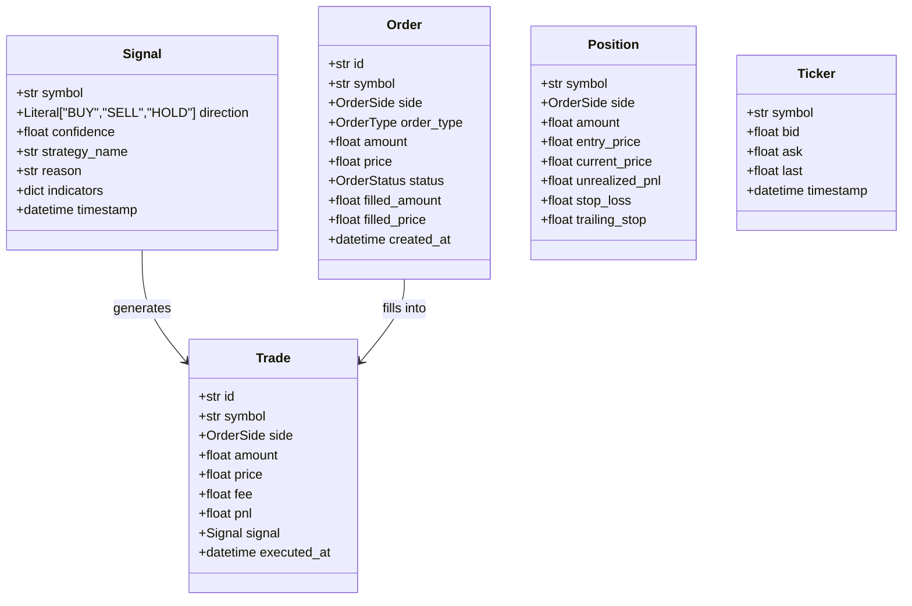

### Exchange Hierarchy

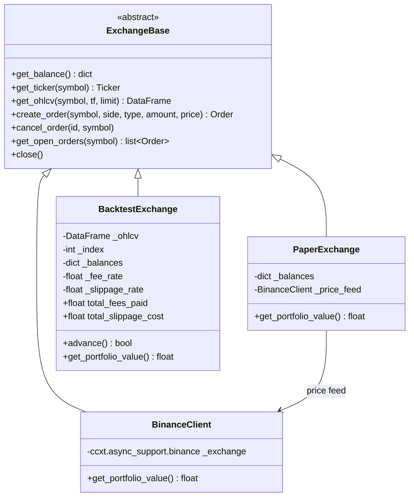

---

## Strategies

### Strategy Flow

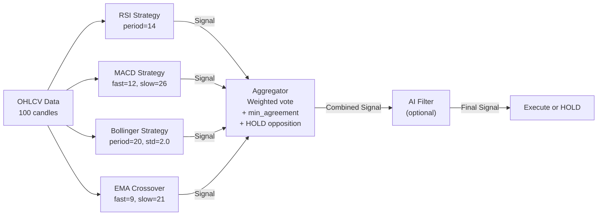

### Signal Aggregation

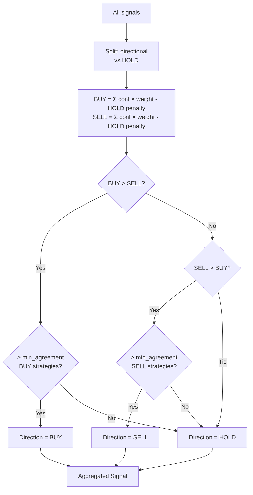

### Regime Detection

The bot uses ADX-based market regime detection to dynamically adjust strategy weights based on market conditions.

**Three Regimes:**
- **Trending** (ADX > threshold + buffer): EMA crossover strategy weight boosted, mean-reversion suppressed
- **Ranging** (ADX < threshold - buffer): RSI/MACD/Bollinger boosted, EMA suppressed  
- **Volatile** (ATR percentile > 80th): All strategy weights reduced for conservative trading

**Hysteresis** prevents whipsaw regime flipping. The ADX must cross a higher band to enter trending and a lower band to exit, avoiding rapid oscillation near the boundary.

```
Data → ADX + ATR Percentile
      │
      ├── ADX > threshold + buffer → TRENDING
      │   └── EMA ×1.5, RSI ×0.2, MACD ×0.3, Bollinger ×0.2
      │
      ├── ATR pct > 80 → VOLATILE
      │   └── All strategies ×0.5
      │
      └── Otherwise → RANGING
          └── EMA ×0.2, RSI ×1.2, MACD ×1.0, Bollinger ×1.2
```

### RSI Strategy Logic

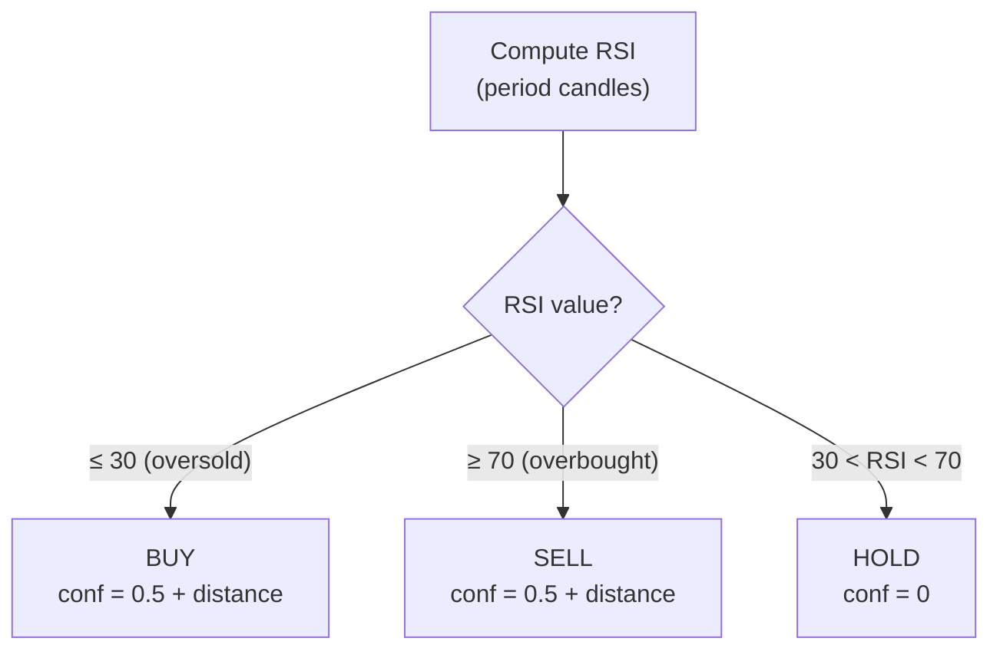

### MACD Strategy Logic

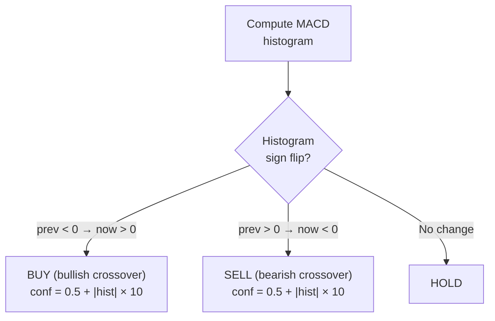

### Bollinger Strategy Logic

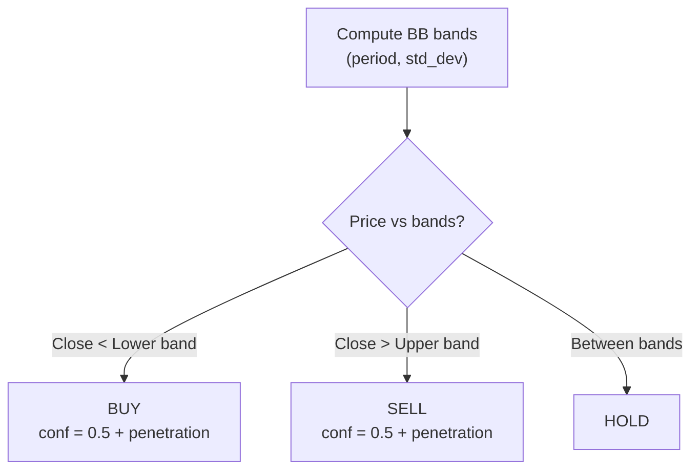

### EMA Crossover Strategy Logic

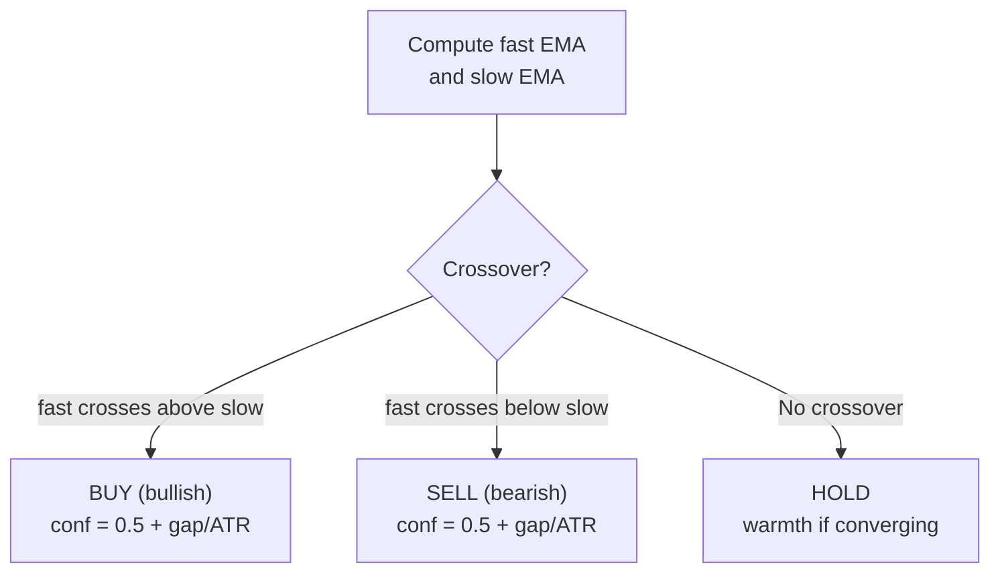

---

## Backtest System

### Complete Backtest Flow

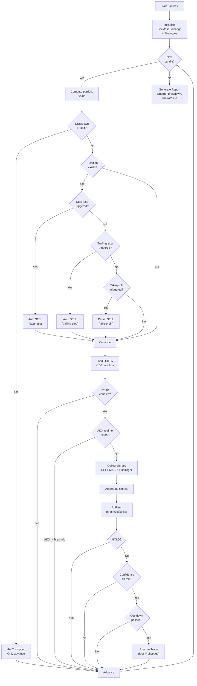

### EngineConfig Parameters

| Field | Type | Default | Description |
|-------|------|---------|-------------|
| `min_confidence` | float | `0.0` | Minimum signal confidence required |
| `cooldown_candles` | int | `0` | Candles between trades |
| `use_dynamic_sizing` | bool | `False` | Position size × confidence |
| `enable_regime_filter` | bool | `False` | ADX trending filter |
| `adx_period` | int | `14` | ADX indicator period |
| `adx_trending_threshold` | float | `25.0` | ADX threshold for trending market |
| `take_profit_pct` | float | `0.0` | Take-profit % (0 = disabled) |
| `take_profit_ratio` | float | `0.5` | Fraction of position to sell at TP |

### BacktestExchange Parameters

| Field | Type | Default | Description |
|-------|------|---------|-------------|
| `fee_rate` | float | `0.001` | Exchange fee per trade (0.1%) |
| `slippage_rate` | float | `0.0005` | Price slippage (0.05%) |

### Report Metrics (BacktestReport)

| Metric | Description |
|--------|-------------|
| `total_return_pct` | Total return % |
| `annualized_return_pct` | Annualized return % |
| `max_drawdown_pct` | Largest peak-to-trough decline |
| `sharpe_ratio` | Risk-adjusted return (risk-free 4%) |
| `sortino_ratio` | Like Sharpe but only downside volatility |
| `total_trades` | Total number of trades |
| `win_rate` | Percentage of profitable trades |
| `avg_trade_pnl` | Average P&L per trade |
| `best_trade_pnl` / `worst_trade_pnl` | Best/worst single trade |

---

## Walk-Forward Validation

Walk-forward splits the loaded OHLCV into sequential **train** / **test** windows, runs a full backtest on each slice with the same strategy and engine parameters, and aggregates **out-of-sample (OOS)** metrics. This reduces overfitting compared to a single in-sample run.

**Module:** [`backend/backtest/walk_forward.py`](backend/backtest/walk_forward.py)

| Parameter | Description |
|-----------|-------------|
| `n_folds` | Number of folds (e.g. 3) |
| `train_pct` | Fraction of each fold used for training (e.g. 0.7) |
| `step_type` | `rolling` — chunk the series into folds; `expanding` — growing train window with sliding test |

**API:** Enable with `walk_forward.enabled: true` on `POST /api/backtest`. Response may include `walk_forward` with `folds[]` (each with `train_report`, `test_report`) and `aggregate_oos` (`avg_return_pct`, `avg_sharpe`, `worst_return_pct`, etc.).

**UI:** Backtest panel → Advanced Settings → Walk-Forward Validation.

### Parameter Optimizer (Optuna)

Automated parameter search using Bayesian optimization (Optuna TPE sampler). Runs N backtest trials with different parameter combinations and ranks results by scoring metric. Optionally validates the best result with walk-forward to detect overfitting.

**Tunable parameter groups:**

| Group | Parameters |
|-------|-----------|
| `strategy` | RSI period/oversold/overbought, MACD fast/slow/signal, Bollinger period/std_dev, EMA fast/slow period |
| `risk` | stop_loss_pct, trailing_stop_pct, max_position_pct, min_confidence, risk_per_trade_pct |
| `atr` | atr_stop_multiplier, atr_tp_multiplier, atr_trailing_multiplier, partial_tp_ratio |
| `guards` | volume_min_multiplier, ema_trend_period, ema_trend_enabled |
| `engine` | cooldown_candles, use_dynamic_sizing |
| `aggregator` | min_agreement (1–4), hold_opposition (0.0–0.3) |
| `regime` | `regime_trending_threshold`, `regime_hysteresis_buffer`, `regime_trending_ema_weight`, `regime_trending_mr_weight`, `regime_ranging_ema_weight`, `regime_ranging_mr_weight` | ADX threshold, hysteresis, per-regime strategy weight multipliers |

**Scoring metrics:** `sharpe` (risk-adjusted return, default), `return` (total return %), `calmar` (return / max drawdown).

**`POST /api/optimize`**

```json
{
  "symbol": "BTC/USDT",
  "timeframe": "1h",
  "start": "2025-01-01",
  "end": "2025-06-30",
  "balance": 10000,
  "strategies": ["rsi", "macd", "bollinger"],
  "n_trials": 50,
  "scoring": "sharpe",
  "tune_groups": ["strategy", "risk", "atr"],
  "validate_best": true,
  "fee_rate": 0.001,
  "slippage_rate": 0.0005
}
```

Response:

```json
{
  "trials": [
    {
      "number": 42,
      "params": { "rsi_period": 10, "stop_loss_pct": 0.04, "atr_stop_multiplier": 2.5 },
      "score": 1.234,
      "metrics": { "sharpe": 1.234, "return_pct": 8.5, "max_drawdown_pct": 3.2, "win_rate": 55.0, "total_trades": 32 }
    }
  ],
  "best_params": { "rsi_period": 10, "stop_loss_pct": 0.04 },
  "best_metrics": { "sharpe": 1.234, "return_pct": 8.5 },
  "best_score": 1.234,
  "validation": { "folds": [], "aggregate_oos": { "avg_return_pct": 3.2, "avg_sharpe": 0.8 } }
}
```

**UI:** Header → Optimizer tab. Configure symbol, dates, trials, scoring, parameter groups. Results show best parameters, all trials table (sortable), and walk-forward validation. "Apply to Backtest" button copies optimal parameters to the Backtest panel.

---

## AI Integration

### AI Layers

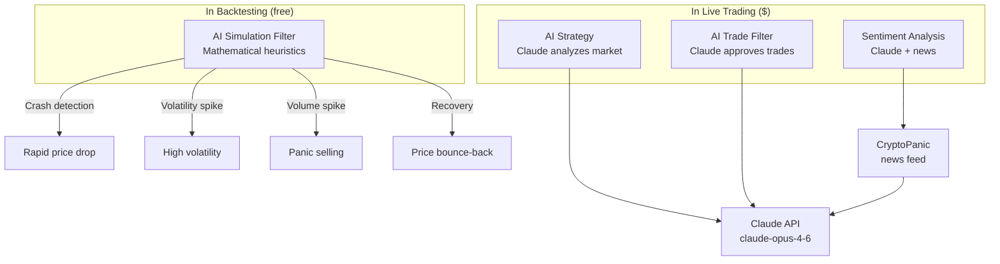

### AI Crash Filter Config

| Field | Type | Default | Description |
|-------|------|---------|-------------|
| `enabled` | bool | `False` | Filter on/off |
| `strength` | float | `0.5` | Filtering intensity (0–1) |
| `crash_lookback` | int | `10` | Candles for crash detection |
| `crash_threshold_pct` | float | `-5.0` | Crash threshold % |
| `volatility_lookback` | int | `20` | Volatility calculation period |
| `volatility_multiplier` | float | `2.0` | Volatility spike multiplier |
| `volume_spike_multiplier` | float | `2.5` | Volume spike multiplier |
| `recovery_boost` | float | `1.3` | Recovery BUY confidence boost |
| `min_confidence_threshold` | float | `0.3` | Min confidence before blocking |

### AI Filter Effect on Signals

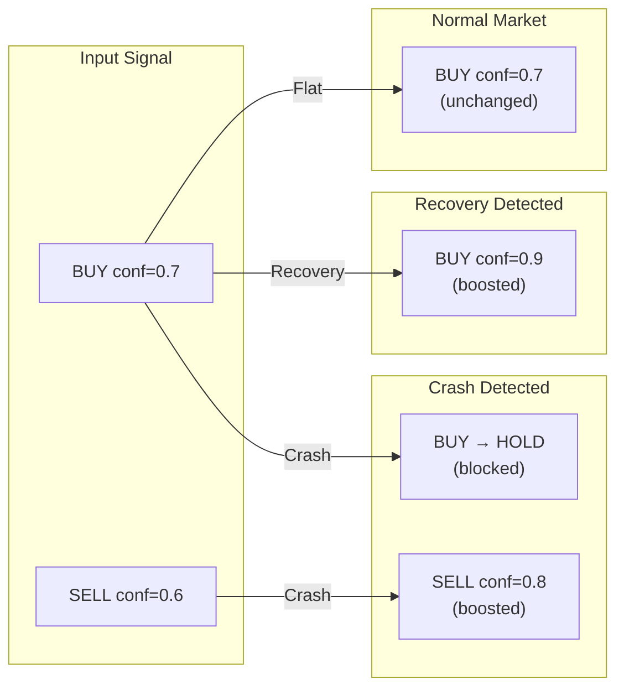

---

## Multi-LLM Veto System

Optional second opinion for live **AI filter strategy** signals. Multiple `LLMProvider` implementations (e.g. `ClaudeClient`, `OpenAIClient`) are queried in parallel; a trade direction is **approved** only if at least `veto_min_agree` providers return the same `direction` (`BUY` / `SELL`) as the proposed signal.

| File | Role |
|------|------|
| [`backend/ai/base_provider.py`](backend/ai/base_provider.py) | `LLMProvider` ABC — `analyze(system_prompt, user_prompt) -> dict` |
| [`backend/ai/openai_client.py`](backend/ai/openai_client.py) | OpenAI Chat Completions, JSON response format |
| [`backend/ai/veto_system.py`](backend/ai/veto_system.py) | `VetoSystem` — `asyncio.gather`, quorum, timeout |
| [`backend/ai/claude_client.py`](backend/ai/claude_client.py) | Implements `LLMProvider` via uncached `analyze()` |

[`AIFilterStrategy`](backend/strategies/ai_strategy.py) accepts optional `veto_system: VetoSystem | None`. When set and Claude proposes BUY/SELL, `evaluate()` runs before returning the signal; on veto, the strategy returns HOLD.

**Secrets:** `OPENAI_API_KEY` in `.env` (see `.env.example`).

---

## Notifications (Telegram)

[`TelegramNotifier`](backend/notifications/telegram.py) sends Markdown messages through the Telegram Bot HTTP API (uses `aiohttp`, no extra dependency).

| Method | Use |
|--------|-----|
| `send_trade(trade, signal)` | After a filled order |
| `send_alert(message, level)` | Errors / circuit breaker |
| `send_daily_summary(stats)` | Optional daily digest |

**Wiring:** Pass `TelegramNotifier(load_settings().telegram)` into `TradingEngine(..., notifier=...)` and call `await notifier.start()` / `close()` around the trading loop lifecycle. The API server lifespan does not start the engine by default; integrate where you launch `TradingEngine`.

---

## Risk Management

### Live Engine Guards

The live/paper trading engine applies the following guards on every tick:

| Guard | Config Field | Behaviour |
|-------|-------------|-----------|
| **RiskManager integration** | `max_drawdown_pct`, `daily_loss_limit_pct` | Portfolio-level drawdown halts all trading; daily loss limit skips the tick |
| **Min confidence** | `min_confidence` | Aggregated signals below this threshold are ignored |
| **Volume confirmation** | `volume_min_multiplier` | Rejects signals when current candle volume < SMA-20 × multiplier |
| **EMA trend filter** | `ema_trend_period`, `ema_trend_enabled` | Only BUY when price > EMA, only SELL when price < EMA |
| **Stale data** | `max_data_age_seconds` | If the latest OHLCV candle is older than this, the symbol is skipped |
| **Max concurrent positions** | `max_concurrent_positions` | New BUYs are blocked when this many positions are already open |
| **Price sanity** | `max_price_deviation_pct` | If the ticker price deviates more than this % from the last candle close, the trade is rejected |
| **ATR dynamic stops** | `atr_stop_multiplier`, `atr_tp_multiplier`, `atr_trailing_multiplier` | Stop-loss, take-profit, and trailing stop derived from ATR-14 at entry (falls back to fixed % when ATR unavailable) |
| **ATR position sizing** | `risk_per_trade_pct` | Sizes positions inversely to volatility: `risk_amount / (ATR × stop_mult)` |
| **Partial take-profit** | `partial_tp_ratio` | Sells a fraction at ATR TP target, moves stop to breakeven for remainder |
| **Strategy weights** | `strategies.weights` | Per-strategy multiplier on confidence (e.g. `{"macd": 1.5, "rsi": 0.8}`) |
| **Min agreement** | `strategies.min_agreement` | Minimum strategies that must agree on BUY/SELL before executing (default 1) |
| **HOLD opposition** | `strategies.hold_opposition` | Penalty weight each HOLD signal applies against directional signals (default 0.0) |
| **Circuit breaker** | `circuit_breaker_threshold` | After N consecutive tick errors, the engine pauses for 5 minutes |
| **Duplicate BUY block** | — | Skips BUY if already holding a position for that symbol |
| **Trade cooldown** | `poll_interval_seconds × 3` | Prevents rapid-fire BUYs on the same symbol |

### Risk Controls in Backtest (Full Parity with Live Engine)

The backtest engine now mirrors every guard and exit condition from the live engine:

| Guard / Feature | Backtest Implementation |
|----------------|------------------------|
| **ATR-based stops** | `RiskManager.calculate_atr()` → stop-loss at `entry - ATR × atr_stop_multiplier` |
| **ATR trailing stop** | `peak - ATR × atr_trailing_multiplier`, updates with new highs |
| **ATR take-profit** | `entry + ATR × atr_tp_multiplier` |
| **Partial take-profit** | Sells `partial_tp_ratio` at ATR TP, moves stop to breakeven |
| **ATR position sizing** | `risk_per_trade_pct × portfolio / (ATR × stop_mult)` caps budget |
| **Volume confirmation** | Same `_check_volume_confirmation()` as live engine |
| **EMA trend filter** | Same `_check_ema_trend()` as live engine |
| **Min confidence** | Max of `EngineConfig.min_confidence` and `RiskConfig.min_confidence` |
| **Cooldown** | Candle-based cooldown between trades |
| **Duplicate BUY block** | No second BUY while position is open |
| **Drawdown halt** | Peak-to-trough drawdown circuit breaker (permanent) |
| **Daily loss limit** | Tracks daily P&L with calendar-day reset |
| **Strategy weighting** | `strategy_weights` dict passed to `_aggregate_signals()` |
| **Min agreement** | `min_agreement` passed through to aggregator (same logic as live) |
| **HOLD opposition** | `hold_opposition` passed through to aggregator (same logic as live) |
| **Percentage fallback** | Falls back to `stop_loss_pct`/`trailing_stop_pct` when ATR is zero |

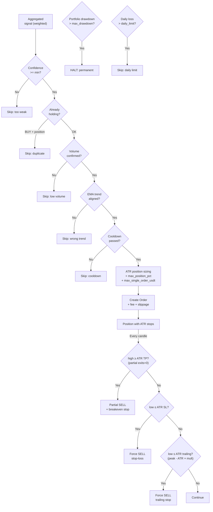

---

## Frontend

### Component Hierarchy

```mermaid
graph TD
    APP["App.tsx"] --> HEAD["Header<br/>Logo, mode, status"]
    APP --> TABS["Tab Navigation<br/>Dashboard | Backtest"]

    TABS --> |Dashboard| DASH["Dashboard View"]
    TABS --> |Backtest| BTP["BacktestPanel"]

    DASH --> SP["StatsPanel<br/>4 stat cards"]
    DASH --> PC["PortfolioChart<br/>Equity curve"]
    DASH --> CP["ConfigPanel<br/>Bot settings + paper trading info"]
    DASH --> TT["TradesTable<br/>Recent trades"]

    BTP --> FORM["Input Form<br/>Symbol, dates, balance"]
    BTP --> STRAT["Strategy Toggles<br/>RSI, MACD, Bollinger, EMA"]
    BTP --> AITOGGLE["AI Crash Filter<br/>Toggle + Strength"]
    BTP --> ADV["Advanced Settings"]
    BTP --> RESULTS["Results"]

    ADV --> COSTS["Trading Costs<br/>Fee, Slippage, Min conf, Cooldown"]
    ADV --> POSMGMT["Position Mgmt<br/>Dynamic sizing, ADX, TP"]
    ADV --> RISK["Risk Mgmt<br/>Stop-loss, Trailing, Max order"]
    ADV --> STRAT_P["Strategy Params<br/>RSI/MACD/Bollinger sliders"]
    ADV --> AI_P["AI Filter Params<br/>Crash lookback, thresholds"]
    ADV --> WF["Walk-Forward<br/>Folds, train %, step type"]

    RESULTS --> CARDS["Stat Cards<br/>Return, Sharpe, Win rate..."]
    RESULTS --> CANDLE["CandlestickChart<br/>+ Trade markers"]
    RESULTS --> EQUITY["Equity Curve<br/>Recharts area"]
    RESULTS --> AISTATS["AI Filter Stats"]
    RESULTS --> ENGSTATS["Engine Stats<br/>Fees, stops, skips"]
    RESULTS --> SIGSPLIT["Strategy Signals<br/>BUY/SELL/HOLD bars"]
    RESULTS --> WFRES["Walk-Forward Table<br/>OOS aggregate"]
    RESULTS --> TRADES["Trade History<br/>Table"]
```

---

## API Reference

### REST Endpoints

All REST endpoints are prefixed with `/api`.

| Method | Path | Parameters | Response |
|--------|------|------------|----------|
| `GET` | `/api/health` | — | `{"status": "ok"}` |
| `GET` | `/api/config` | — | Bot configuration (mode, pairs, `paper_trading.initial_balance_usdt`, risk, strategies) |
| `GET` | `/api/trades` | `?symbol=&limit=50` | List of trades |
| `GET` | `/api/orders` | `?symbol=` | Open orders |
| `GET` | `/api/portfolio` | `?limit=100` | Portfolio history |
| `GET` | `/api/signals` | `?symbol=&strategy=&limit=50` | Signal log: per-strategy + aggregated signals from each engine cycle |
| `GET` | `/api/bot/status` | — | In-process paper loop: `state`, `mode`, `control_enabled`, `last_error` |
| `POST` | `/api/bot/start` | — | Starts `TradingEngine` inside the API process (**`trading.mode` must be `paper`**). `403` if `BOT_CONTROL_ENABLED` is false |
| `POST` | `/api/bot/stop` | — | Stops the in-process loop (may take up to one poll interval) |
| `PATCH` | `/api/bot/settings` | JSON body (all optional): `initial_balance_usdt`, `pairs`, `timeframe`, `poll_interval_seconds`, `strategies` | Merges allowed fields into project `config.yaml`. `strategies` replaces `strategies.enabled` and must include at least one of `rsi` / `macd` / `bollinger`. **`409` if the bot is not stopped** |
| `POST` | `/api/backtest` | JSON body (see below) | Report + equity + OHLCV + trades |

**Paper dashboard control:** With `trading.mode: paper`, the React dashboard can start/stop the bot and edit paper settings without restarting uvicorn. Changing `initial_balance_usdt` affects the next run, not an already-running simulated book. Disable remote start/stop with `BOT_CONTROL_ENABLED=false` in `.env`.

If the dashboard shows **Not Found** for bot actions, the API process is missing `/api/bot/*` routes — restart it with the current code using `uvicorn backend.api.app:app` (port `8000` must match the Vite proxy in `frontend/vite.config.ts`).

### WebSocket

| Path | Description |
|------|-------------|
| `/ws` | Live updates — message types: `pong`, `signal` (per-cycle aggregated signal with `symbol`, `direction`, `confidence`, `reason`, `indicators`, `timestamp`) |

### POST `/api/backtest` Request

```json
{
  "symbol": "BTC/USDT",
  "timeframe": "1h",
  "start": "2025-01-01",
  "end": "2025-06-30",
  "balance": 10000.0,
  "strategies": ["rsi", "macd", "bollinger", "ema"],
  "strategy_weights": { "rsi": 1.0, "macd": 1.5, "bollinger": 0.8, "ema": 1.2 },
  "rsi": { "period": 14, "oversold": 30, "overbought": 70 },
  "macd": { "fast": 12, "slow": 26, "signal": 9 },
  "bollinger": { "period": 20, "std_dev": 2.0 },
  "ema": { "fast_period": 9, "slow_period": 21 },
  "regime": {
    "enabled": true,
    "trending_threshold": 25.0,
    "hysteresis_buffer": 5.0,
    "trending_ema_weight": 1.5,
    "trending_mr_weight": 0.2,
    "ranging_ema_weight": 0.2,
    "ranging_mr_weight": 1.2
  },
  "min_agreement": 2,
  "hold_opposition": 0.1,
  "risk": {
    "max_position_pct": 0.10,
    "stop_loss_pct": 0.03,
    "trailing_stop_pct": 0.02,
    "max_single_order_usdt": 1000.0,
    "max_drawdown_pct": 0.15,
    "daily_loss_limit_pct": 0.05,
    "min_confidence": 0.4,
    "atr_stop_multiplier": 2.0,
    "atr_tp_multiplier": 3.0,
    "atr_trailing_multiplier": 1.5,
    "volume_min_multiplier": 1.2,
    "ema_trend_period": 50,
    "ema_trend_enabled": true,
    "risk_per_trade_pct": 0.01,
    "partial_tp_ratio": 0.5
  },
  "ai_filter": {
    "enabled": false,
    "strength": 0.5,
    "crash_lookback": 10,
    "crash_threshold_pct": -5.0,
    "volatility_multiplier": 2.0,
    "volume_spike_multiplier": 2.5,
    "recovery_boost": 1.3
  },
  "engine": {
    "fee_rate": 0.001,
    "slippage_rate": 0.0005,
    "min_confidence": 0.0,
    "cooldown_candles": 0,
    "use_dynamic_sizing": false,
    "enable_regime_filter": false,
    "adx_trending_threshold": 25.0,
    "take_profit_pct": 0.0,
    "take_profit_ratio": 0.5
  },
  "walk_forward": {
    "enabled": false,
    "n_folds": 3,
    "train_pct": 0.7,
    "step_type": "rolling"
  }
}
```

When `walk_forward.enabled` is `true`, the response includes a `walk_forward` object with `folds` and `aggregate_oos` in addition to the full-period backtest above.

### POST `/api/backtest` Response

```json
{
  "report": {
    "initial_value": 10000.0,
    "final_value": 10850.0,
    "total_return_pct": 8.5,
    "annualized_return_pct": 17.2,
    "max_drawdown_pct": 5.3,
    "sharpe_ratio": 1.24,
    "sortino_ratio": 1.89,
    "total_trades": 23,
    "winning_trades": 14,
    "losing_trades": 9,
    "win_rate": 60.9,
    "avg_trade_pnl": 36.96,
    "best_trade_pnl": 210.50,
    "worst_trade_pnl": -85.20,
    "strategy_stats": { "aggregator": { "BUY": 12, "SELL": 11, "HOLD": 3800 } },
    "ai_filter_stats": { "signals_reviewed": 0, "..." : "..." },
    "engine_stats": {
      "stop_loss_exits": 3,
      "trailing_stop_exits": 2,
      "take_profit_exits": 1,
      "partial_tp_exits": 1,
      "drawdown_halt_candle": null,
      "daily_loss_skips": 0,
      "signals_below_confidence": 5,
      "cooldown_skips": 8,
      "regime_filtered": 120,
      "volume_filtered": 15,
      "ema_filtered": 8,
      "total_fees": 23.45,
      "total_slippage": 11.22
    }
  },
  "equity_curve": [10000.0, 10002.5, "..."],
  "timestamps": ["2025-01-01T00:00:00+00:00", "..."],
  "ohlcv": [{ "time": 1735689600, "open": 42000, "high": 42500, "low": 41800, "close": 42200, "volume": 150.5 }],
  "trades": [{ "symbol": "BTC/USDT", "side": "BUY", "amount": 0.0023, "price": 42150.0, "executed_at": "2025-01-15T14:00:00+00:00", "portfolio_value": 10050.0 }],
  "walk_forward": {
    "folds": [
      {
        "fold_index": 1,
        "train_start": "...",
        "train_end": "...",
        "test_start": "...",
        "test_end": "...",
        "train_report": { "total_return_pct": 0, "sharpe_ratio": 0 },
        "test_report": { "total_return_pct": 0, "sharpe_ratio": 0 }
      }
    ],
    "aggregate_oos": {
      "avg_return_pct": 0,
      "avg_sharpe": 0,
      "n_folds": 3
    }
  }
}
```

Omitted when `walk_forward.enabled` is `false`.

---

## Data Flow Diagrams

### Live Trading Flow

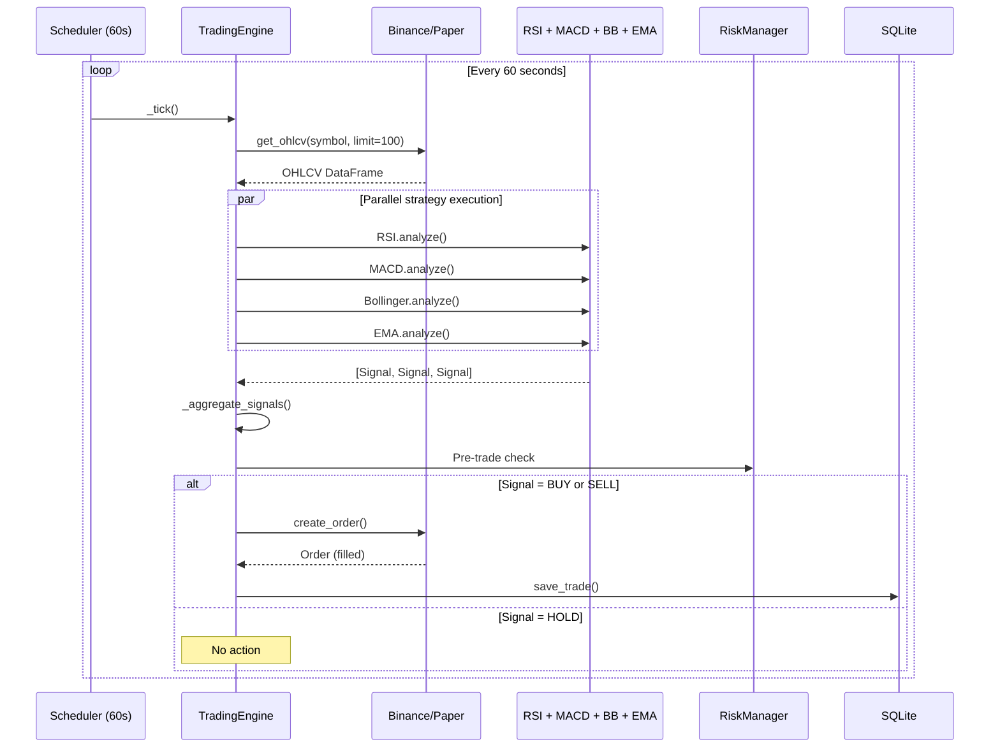

### Backtest Data Flow

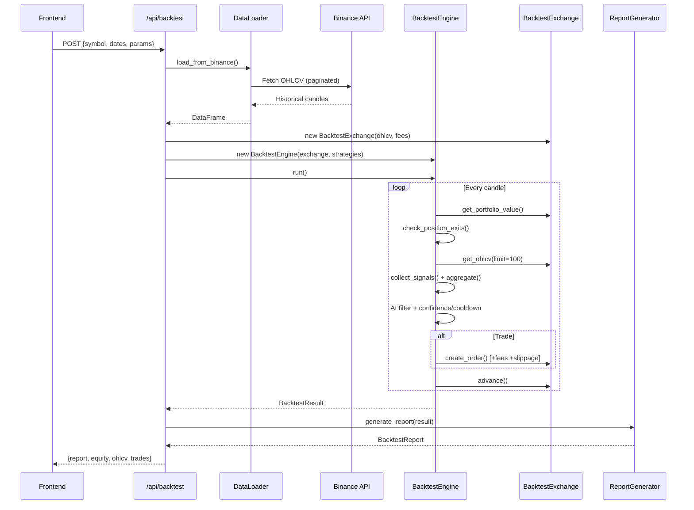

---

## Environment Variables (.env)

```bash
BINANCE_API_KEY=your_binance_api_key
BINANCE_API_SECRET=your_binance_api_secret
ANTHROPIC_API_KEY=your_anthropic_api_key
OPENAI_API_KEY=             # Multi-LLM veto (OpenAI provider)
TELEGRAM_BOT_TOKEN=         # Optional trade / alert notifications
TELEGRAM_CHAT_ID=
TRADING_MODE=paper          # paper | live | backtest
LOG_LEVEL=INFO              # DEBUG | INFO | WARNING
```

---

## Getting Started

```bash
# Backend (API server) — required for dashboard + /api/bot/* Start/Stop
uvicorn backend.api.app:app --host 0.0.0.0 --port 8000 --reload

# Frontend (dev server; proxies /api and /ws to port 8000)
cd frontend && npm run dev

# Live/Paper trading bot
python -m backend.main

# CLI backtest
python -m backend.backtest --symbol BTC/USDT --start 2025-01-01 --end 2025-06-30

# Tests
python -m pytest tests/ -v

# Lint
ruff check backend/ tests/
```

---

## Test Coverage

| Module | Test Count | Covered Functionality |
|--------|------------|----------------------|
| `tests/backtest/test_ai_filter.py` | 11 | Crash detection, recovery, strength, stats |
| `tests/backtest/test_engine.py` | 4 | Base engine execution, trending data, equity curve |
| `tests/backtest/test_engine_advanced.py` | 10 | Fees, slippage, stop-loss, trailing, cooldown, drawdown, dynamic sizing |
| `tests/backtest/test_engine_parity.py` | 30 | ATR stops/TP/trailing, volume filter, EMA filter, confidence, cooldown, drawdown halt, daily loss limit, ATR sizing, strategy weights, partial TP, percentage fallback, regime filter, multi-day reset, full cycle, min_agreement parity, EMA strategy parity |
| `tests/backtest/test_exchange.py` | 12 | Exchange balances, orders, insufficient funds |
| `tests/backtest/test_data_loader.py` | 3 | CSV round-trip, timezone handling |
| `tests/backtest/test_report.py` | 12 | Drawdown, returns, Sharpe, report generation |
| `tests/backtest/test_walk_forward.py` | 10 | Fold splitting, rolling/expanding, OOS aggregation |
| `tests/backtest/test_optimizer.py` | 12 | Optuna integration, parameter building, EMA + aggregator configs, scoring metrics, walk-forward validation |
| **Total `tests/backtest/`** | **104** | (all backtest-related modules) |
| `tests/notifications/test_telegram.py` | 11 | Telegram API payload, disabled path, session lifecycle |
| `tests/ai/test_openai_client.py` | 5 | OpenAI JSON parsing, LLMProvider |
| `tests/ai/test_veto_system.py` | 9 | Quorum, failures, timeouts |
| `tests/test_database.py` | 11 | Trades, orders, portfolio snapshots, signal log insert/query/filters |
| `tests/core/test_engine.py` | 35+ | Signal aggregation, tick execution, ATR stops, volume filter, EMA trend, strategy weights, partial TP, min_agreement, hold_opposition |
| `tests/core/test_engine_scenarios.py` | 63 | End-to-end scenarios: slippage, whipsaw, flash crash, exchange errors, multi-position, halt persistence |
| `tests/api/test_routes.py` | 13 | REST endpoints: health, config, trades, orders, portfolio, signals |
| `tests/strategies/test_ema_strategy.py` | 8 | EMA crossover: bullish/bearish signals, HOLD, confidence scaling, config |
| `core/regime.py` | 23 | Regime classification, hysteresis, weight maps, ATR percentile |
| `tests/` (all) | **419** | Full suite — `pytest tests/ -v` |
